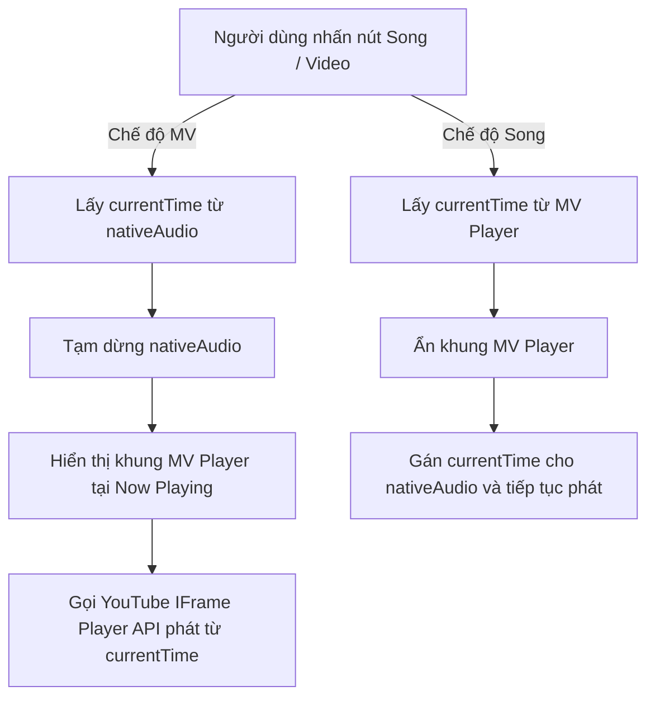

# Kế hoạch Tích hợp Trình phát MV (Song/Video Switcher) vào Eclipse

## 1. Mục tiêu
Mang trải nghiệm chuyển đổi **Bài hát / MV** (tương tự Pear Desktop `video-toggle`) vào giao diện Native Material 3 của Eclipse:
- Nhấn **MV**: Hiển thị video ca nhạc YouTube ngay tại giao diện Now Playing, đồng bộ giây phát hiện tại.
- Nhấn **Song**: Quay về chế độ tiết kiệm tài nguyên (Audio native + Lời bài hát karaoke Zing MP3/LRC).
- Tự động điều khiển Play/Pause/Seek đồng bộ giữa native audio và video player.

---

## 2. Thiết kế Kỹ thuật

### Thành phần can thiệp:
1. **`src/renderer/index.html`**:
   - Thêm nút switcher `[ Âm nhạc | MV ]` trên thanh Now Playing bar và màn hình chi tiết bài hát (Now Playing View).
   - Thêm container `#nowPlayingVideoContainer` chứa khung chiếu video YouTube (ẩn mặc định).

2. **`src/renderer/app.js`**:
   - Tích hợp YouTube IFrame Player API (`YT.Player`).
   - Hàm `switchPlaybackMode(mode: 'audio' | 'video')`:
     - Đồng bộ mượt mà timestamp giữa `<audio id="nativeAudio">` và `YT.Player`.
     - Đồng bộ trạng thái Play/Pause: khi bấm nút Play ở dưới bottom bar, video trong khung cũng Play/Pause tương ứng.
     - Đồng bộ Next/Previous bài hát: tự load videoId bài mới vào player khi chuyển bài.

3. **`src/renderer/styles.css` / CSS tokens**:
   - Định dạng khung MV Player bo góc Material 3, tỉ lệ 16:9, responsive theo kích thước cửa sổ.
   - Hiệu ứng chuyển cảnh mượt giữa Album Art và MV Player.

---

## 3. Các bước triển khai (Phase Breakdown)

1. **Bước 1: Khởi tạo UI Container & Switcher Button**
   - Thêm nút chuyển chế độ Song/Video với icon trực quan.
   - Đặt khung video vào vị trí Cover Art của màn hình Now Playing.

2. **Bước 2: Tích hợp YouTube IFrame Player API & Logic Sync**
   - Khởi tạo controller player nhúng `https://www.youtube-nocookie.com/embed/...`.
   - Viết logic 2 chiều: `Audio -> Video` và `Video -> Audio`.

3. **Bước 3: Kiểm thử đồng bộ & Ngoại lệ**
   - Bài hát không phải YouTube (nhạc local offline) -> tự động ẩn nút MV.
   - Thử nghiệm seek thanh thời gian, đổi bài trong playlist, tua bài.
   - Chạy automated syntax & unit tests.

4. **Bước 4: Build & Đóng gói binary v1.2.0**
   - Chạy `npm run dist -- --dir`.
   - Đẩy commit & tag lên Git.
